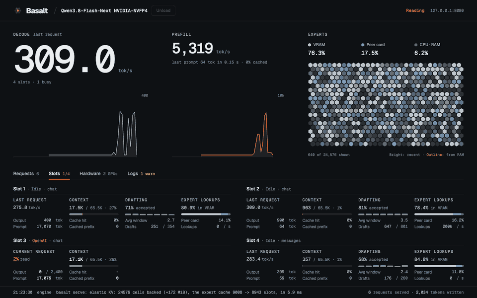

<p align="center"><picture><source media="(prefers-color-scheme: dark)" srcset="assets/basalt-lockup-dark.png"></picture></p>

> [!NOTE]
> **This fork runs Basalt on NVIDIA Ada GPUs (compute capability 8.9)** — the RTX 40-series from the 4050 to the 4090,
> plus Ada datacenter cards (L4, L40S, RTX 6000 Ada), where upstream requires Blackwell (sm_120/121). Same OpenAI/
> Anthropic server, same experts-in-system-RAM memory model: a 16 GB card runs the MoE models that do not fit in VRAM.
> Ada support is **additive** — every Blackwell kernel is untouched (guarded by `__CUDA_ARCH__` + a runtime capability
> check), so the Blackwell build stays bit-for-bit upstream. Tested on RTX 40-series hardware: the full GPU
> parity suite passes (163/163) and the quality gate is byte-identical to the pre-port engine. Build with `-DBASALT_CUDA_ARCHITECTURES=89` (or `120;89` to run Blackwell and Ada tiers together);
> see [ADA_PORT_NOTES.md](ADA_PORT_NOTES.md) for the port design, and
> [jesdga95/basalt](https://github.com/jesdga95/basalt) for the engine itself.

Basalt is a local inference engine for large language models: **Qwen3.8-Flash-Next**, **DeepSeek-V4.1-Flash**, **Qwen3.8-27B**, **Hy4-flash** and **Inkling 2 Mini**. It runs
on an NVIDIA Blackwell GPU (sm_120) - or, in this fork, an Ada GPU (sm_89, RTX 40-series) - on Linux and Windows x64, and on the DGX Spark (GB10, Arm64), with what does not fit in VRAM
(the experts of a mixture-of-experts model) in system RAM, and optionally on more GPUs. The server speaks the OpenAI and Anthropic APIs. Website: [basalt.jgulfo.com](https://basalt.jgulfo.com).

<p align="center"></p>

**Help wanted:** spare Blackwell compute for testing? See [Contributing](CONTRIBUTING.md#other-ways-to-help).

<p align="center">
  <a href="https://github.com/sponsors/jesdga95"></a>
  <a href="https://ko-fi.com/jesdga"></a>
  <a href="https://paypal.me/jesdga"></a>
</p>

## Requirements

- Linux x86-64 with AVX2, or Windows 10 1903+ x64, with an NVIDIA Blackwell GPU (compute capability 12.0) - or, in this fork, an Ada GPU (compute capability 8.9: RTX 4050-4090, L4, L40S, RTX 6000 Ada) ([platforms](docs/platforms.md)).
- Or a DGX Spark or another GB10 machine: Linux Arm64 with its integrated Blackwell GPU (12.1) ([Arm64](docs/arm64.md)).
- CUDA 13.
- CMake 3.24+, GCC 13+ (Linux), Python 3.10+, and enough system RAM for the experts that do not fit in VRAM.

## Quick start

This fork builds from source; its [releases](https://github.com/FahadAlAlawi/basalt-RTX40/releases) carry prebuilt Linux x64, Linux Arm64 and Windows x64 archives built for the 40-series alongside Blackwell (upstream's [releases](https://github.com/jesdga95/basalt/releases), [what they need](docs/platforms.md#release-archives), target Blackwell only):

```sh
git clone https://github.com/FahadAlAlawi/basalt-RTX40 && cd basalt-RTX40
cmake -S . -B build -DCMAKE_BUILD_TYPE=Release -DCMAKE_CUDA_ARCHITECTURES=89 -DBASALT_MODELS=all
                                        # 89 = Ada (RTX 40-series); Blackwell cards: omit the arch flag (120 is the default); mixed Blackwell + Ada: "120;89"
cmake --build build -j                  # bin/basalt, bin/basalt-bench, bin/basalt-probe, bin/basalt-vision
                                        # Windows: add -G Ninja to the first line, from an x64 VS 2022 prompt ([platforms](docs/platforms.md#building-on-windows))
                                        # -DBASALT_MODELS is required: all, or the ids of the models you want, such as -DBASALT_MODELS=qwen4exp ([building](docs/building.md#building-only-some-models))
pip install -r requirements.txt
hf download jesdga/Qwen3.8-Flash-Next-Basalt Qwen3.8-FN-NVFP4-DQ6_K.basalt --local-dir models
```

Put the settings in `basalt_config.json`:

```json
{
  "version": 2,
  "models": [{ "model": "models/Qwen3.8-FN-NVFP4-DQ6_K.basalt", "gpu": "0", "kv": "int8" }],
  "engine": { "resident-experts": true },
  "server": { "port": 8080 }
}
```

```sh
bin/basalt serve --config basalt_config.json
```

With a second GPU set `"gpu": "0,1"` and `"gpu-mode": "peer"` - in this fork the cards may be Ada, Blackwell or mixed (build `"120;89"`); `gpu-mode` stays unset with one card.

The server listens on 127.0.0.1. Every setting: [configuration](docs/configuration/index.md). More examples:
[example configurations](docs/configuration/examples.md).

## Models

| | Qwen3.8-Flash-Next | DeepSeek-V4.1-Flash | Qwen3.8-27B | Hy4-flash | Inkling 2 Mini |
|---|---|---|---|---|---|
| Packs | default `Qwen3.8-FN-NVFP4-DQ6_K`, [Hugging Face](https://huggingface.co/jesdga/Qwen3.8-Flash-Next-Basalt) | default `DeepSeek-V4.1-Flash-1017-UD-IQ1_M`, [Hugging Face](https://huggingface.co/jesdga/DeepSeek-V4.1-Flash-1017-Basalt) | `Qwen3.8-27B-QUASAR-NVFP4`, [Hugging Face](https://huggingface.co/jesdga/Qwen3.8-27B-Basalt) | `Hy4-flash-NVFP4`, [Hugging Face](https://huggingface.co/jesdga/Hy4-flash-Basalt) | `Inkling-2-Mini-NVFP4-MX8`, [Hugging Face](https://huggingface.co/jesdga/Inkling-2-Mini-Basalt) |
| Context | up to 262,144 (longer with YaRN) | up to 1,048,576 | up to 262,144 | up to 1,048,576 | up to 1,048,576 |
| Drafting | MTP, on by default | DSpark, on by default | DFlash 2, on by default | DFly2, on by default | DSpark, on by default |
| Images | yes | yes | yes | yes | yes |
| Documents (PDF, text) | yes | yes | yes | yes | yes |
| Guide | [guide](docs/models/qwen38-flash-next.md) | [guide](docs/models/deepseek41.md) | [guide](docs/models/qwen38-27b.md) | [guide](docs/models/hy4-flash.md) | [guide](docs/models/inkling2.md) |
| Precision | [precision](docs/precision/qwen38-flash-next.md) | [precision](docs/precision/deepseek41.md) | [precision](docs/precision/qwen38-27b.md) | [precision](docs/precision/hy4-flash.md) | [precision](docs/precision/inkling2.md) |

All models compared, with each one's context limit, flags and cards: [models](docs/models/index.md). On this fork every model builds and passes its kernel parity tests on Ada (sm_89); the Flash-Next NVFP4 pack is verified end to end, and the two-card Ada paths are ported but not yet exercised on two physical Ada cards - see [ADA_PORT_NOTES.md](ADA_PORT_NOTES.md).

The context limits are the models' own; what a card actually runs is set by the KV-cache budget - `--kv int8` halves it, and [configuration](docs/configuration/index.md) covers the rest.

## Video

Qwen3.8-Flash-Next and Qwen3.8-27B read video; DeepSeek, Hy4-flash and Inkling 2 Mini do not. A video is named like an image in a chat message, and needs
`--vision` and FFmpeg on the machine. Flash-Next decodes frames on the GPU with NVDEC; the 27B decodes them on the CPU.
How a request names a video, and the limits: [video](docs/running.md#video).

## Documentation

- **Run:** [running](docs/running.md), [configuration](docs/configuration/index.md), [models and the router](docs/configuration/models.md),
  [sampling](docs/configuration/sampling.md), [image sources](docs/configuration/image-sources.md),
  [documents](docs/configuration/documents.md),
  [diagnostics](docs/configuration/diagnostics.md), [basalt-probe](docs/probe.md), [platforms](docs/platforms.md).
- **Models:** [models](docs/models/index.md), [Flash-Next](docs/models/qwen38-flash-next.md), [DeepSeek](docs/models/deepseek41.md),
  [Qwen3.8-27B](docs/models/qwen38-27b.md), [Hy4-flash](docs/models/hy4-flash.md), [Inkling 2 Mini](docs/models/inkling2.md),
  [the `.basalt` file](docs/model-file.md), [file format changes](docs/basalt-file-changelog.md).
- **Quality:** [precision](docs/precision/index.md), [method](docs/precision/quality.md).
- **Build and develop:** [building](docs/building.md), [adding a model](docs/adding-a-model.md), [community runs](docs/community.md),
  [changelog](docs/changelog/index.md), [Ada port notes](ADA_PORT_NOTES.md), [contributing](CONTRIBUTING.md).

## Credits

- **Code:** [Strata](https://github.com/Niko1221/Strata), the project Basalt forks (MIT); [Infernix](https://github.com/Wallawalla47/Infernix)
  (Ian Ranson and contributors, Apache-2.0), whose kernels are adapted; [ggml and llama.cpp](https://github.com/ggml-org/llama.cpp)
  (MIT); and ideas from [NInfer](https://github.com/Neroued/ninfer). Licences: [THIRD_PARTY_LICENSES](THIRD_PARTY_LICENSES).
- **Models:** [Qwen](https://huggingface.co/Qwen), [DeepSeek](https://huggingface.co/deepseek-ai), [Tencent](https://huggingface.co/tencent) (Hy4-flash) and Thinking Machines Lab (Inkling 2 Mini), under the licences on their cards;
  [Unsloth](https://huggingface.co/unsloth)'s GGUFs; [NVIDIA](https://huggingface.co/nvidia)'s NVFP4 checkpoints;
  [QUASAR-QAT](https://huggingface.co/QUASAR-QAT/Qwen3.8-27B-QUASAR-NVFP4)'s NVFP4 27B (Apache-2.0); [z-lab](https://huggingface.co/z-lab/Qwen3.8-27B-DFlash2)'s DFlash 2 drafter.

Thank you to everyone who has [contributed](https://github.com/jesdga95/basalt/graphs/contributors) or
[sponsored](https://github.com/sponsors/jesdga95) the project.

## License

MIT, see [LICENSE](LICENSE).
