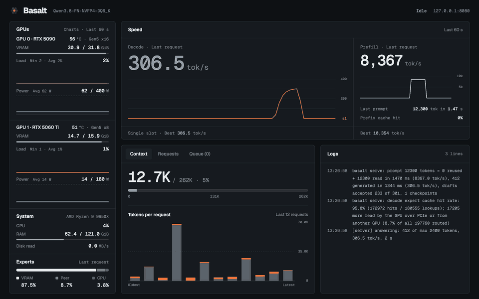

<p align="center"><picture><source media="(prefers-color-scheme: dark)" srcset="assets/basalt-lockup-dark.png"></picture></p>

Basalt is a local inference engine for mixture-of-experts models: **Qwen3.8-Flash-Next** and **DeepSeek-V4.1-Flash**. It runs on
an NVIDIA Blackwell GPU (sm_120) on Linux and Windows x64, with the experts that do not fit in VRAM in system RAM (and optionally
on more GPUs). The server speaks the OpenAI and Anthropic APIs.

<p align="center"></p>

**Help wanted:** spare Blackwell compute for testing? See [Contributing](CONTRIBUTING.md#other-ways-to-help).

## Requirements

- Linux x86-64 with AVX2, or Windows 10 1903+ x64 ([platforms](docs/platforms.md)).
- An NVIDIA Blackwell GPU (compute capability 12.0) with CUDA 13.
- CMake 3.24+, GCC 13+ (Linux), Python 3.10+, and enough system RAM for the experts that do not fit in VRAM.

## Quick start

```sh
git clone https://github.com/jesdga95/basalt && cd basalt
cmake -S . -B build -DCMAKE_BUILD_TYPE=Release
cmake --build build -j                  # bin/basalt, bin/basalt-bench, bin/basalt-probe, bin/basalt-vision
pip install -r requirements.txt
hf download jesdga/Qwen3.8-Flash-Next-Basalt Qwen3.8-FN-NVFP4-DQ6_K.basalt --local-dir models
```

Put the settings in `basalt_config.json`:

```json
{
  "version": 2,
  "models": [{ "model": "models/Qwen3.8-FN-NVFP4-DQ6_K.basalt", "gpu": "0,1", "kv": "int8" }],
  "engine": { "resident-experts": true },
  "server": { "port": 8080 }
}
```

```sh
bin/basalt serve --config basalt_config.json
```

The server listens on 127.0.0.1. Every setting: [configuration](docs/configuration/index.md). More examples:
[example configurations](docs/configuration/examples.md).

## Models

| | Qwen3.8-Flash-Next | DeepSeek-V4.1-Flash |
|---|---|---|
| Packs | 11 packs, default `Qwen3.8-FN-NVFP4-DQ6_K`, [Hugging Face](https://huggingface.co/jesdga/Qwen3.8-Flash-Next-Basalt) | 2 packs, `DeepSeek-V4.1-Flash-1017-UD-IQ1_M` and `-UD-IQ2_XXS`, [Hugging Face](https://huggingface.co/jesdga/DeepSeek-V4.1-Flash-1017-Basalt) |
| Context | default 8,192; `--max-context` sets it | default 8,192; `--max-context` sets it, up to 1,048,576 |
| Drafting | MTP, on by default | DSpark, on by default |
| Images | yes | yes |
| Guide | [guide](docs/models/qwen38-flash-next.md) | [guide](docs/models/deepseek41.md) |
| Precision | [precision](docs/precision/qwen38-flash-next.md) | [precision](docs/precision/deepseek41.md) |

All models compared: [models](docs/models/index.md).

## Documentation

- **Run:** [running](docs/running.md), [configuration](docs/configuration/index.md), [models and the router](docs/configuration/models.md),
  [sampling](docs/configuration/sampling.md), [image sources](docs/configuration/image-sources.md),
  [diagnostics](docs/configuration/diagnostics.md), [basalt-probe](docs/probe.md), [platforms](docs/platforms.md).
- **Models:** [models](docs/models/index.md), [Flash-Next](docs/models/qwen38-flash-next.md), [DeepSeek](docs/models/deepseek41.md),
  [the `.basalt` file](docs/model-file.md), [file format changes](docs/basalt-file-changelog.md).
- **Quality:** [precision](docs/precision/index.md), [method](docs/precision/quality.md).
- **Build and develop:** [building](docs/building.md), [adding a model](docs/adding-a-model.md), [community runs](docs/community.md),
  [changelog](docs/changelog/index.md), [contributing](CONTRIBUTING.md).

## Credits

- [Strata](https://github.com/Niko1221/Strata): the project Basalt forks (MIT).
- [Qwen](https://huggingface.co/Qwen/Qwen3.8-Flash-Next) and [DeepSeek](https://huggingface.co/deepseek-ai/DeepSeek-V4.1-Flash-1017):
  the models. Their packs carry the models' own licences (see the Hugging Face cards).
- [unsloth](https://huggingface.co/unsloth) (GGUFs), [NVIDIA](https://huggingface.co/nvidia/Qwen3.8-Flash-Next-NVFP4) (NVFP4 experts).
- [@giveen](https://huggingface.co/giveen): the BF16 reference for the DeepSeek quality numbers.
- [ggml and llama.cpp](https://github.com/ggml-org/llama.cpp): quantization formats and kernels in `src/` (MIT,
  [THIRD_PARTY_LICENSES](THIRD_PARTY_LICENSES)).

## License

MIT, see [LICENSE](LICENSE).
